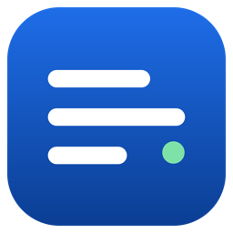
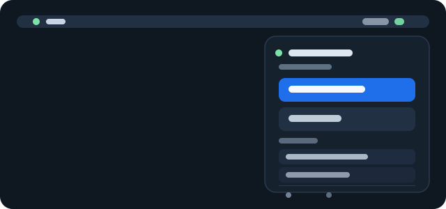

<div align="center">



# DSH Flick

**不管在哪个窗口，轻点一下就批准 DeepSeek Harness 的权限请求。**

一个轻量的 macOS 菜单栏小工具，配合 DeepSeek Harness（DSH）使用。DSH 窗口不在眼前时，它的权限请求会出现在菜单栏，点一下就能处理。

[](#安装)
[](#安装)
[](#开发)
[](#安装)
[](https://github.com/rigelmansid/dsh-flick/releases/latest)
[](LICENSE)

[English](README.md) · **简体中文**

</div>

<p align="center">
  
</p>

> 非官方个人项目，与 DeepSeek 官方无关。图标为原创，不包含 DeepSeek 官方图形资产；详见[商标与致谢](#商标与致谢)。

---

## 为什么是 DSH Flick

- **在哪都能批。** DSH 窗口最小化了、在别的桌面（Space）、或者被全屏应用挡住，新的权限请求都会出现在菜单栏面板里，
  写明来自哪个会话、要什么权限。直接点「**拒绝**」或「**允许一次**」，或者点「**查看详情**」跳到那个会话。
  不用切窗口，agent 就能接着干活。
- **刻意做得很轻。** 只有一个原生小面板：打开 DSH、新建会话、最近 5 个会话、待审批。不显示 Dock 图标，
  没有第三方依赖，不需要辅助功能权限。
- **跟 DSH 同进同退。** DSH 打开时由插件拉起，DSH 退出时它也退出。不加登录项，不留后台进程。
- **只在本机。** 只访问 `127.0.0.1`，DSH 的登录态只读不写。

---

## 功能

### 审批
- 每条审批写明会话标题、请求的权限，并提供「**拒绝 / 允许一次 / 查看详情**」
- 回传走的是 DSH 输入框用的同一个 `PendingApproval.answer()`，所以菜单栏和主窗口对「还有哪些待审批」的判断始终一致
- 多个会话同时等待时纵向堆叠，面板增高到上限后内部滚动
- 有待审批时图标上一直显示红色数量角标
- 插件设置「**审批自动弹出**」默认开启：DSH 不可见时，新请求会自动弹出面板。关掉后只保留角标

### 会话
- **打开 DeepSeek Harness**：把主窗口带到前台，没开就启动它
- **新建会话**：在当前或最近的工作区新建会话并打开
- **最近会话**：最近 5 个顶层会话，点一下跳转

### 菜单栏
- 原创单色模板图标，自动适配浅色 / 深色菜单栏，离线时变暗
- 全局热键 **⌥⌘D**：在任何应用里显示 / 收起面板。用 Carbon `RegisterEventHotKey` 实现，不需要辅助功能或输入监控权限
- 「**隐藏图标**」只在本次 DSH 运行期间隐藏，下次 DSH 启动时恢复

---

## 两种运行方式

| | **插件模式**（推荐） | **独立版** |
| --- | --- | --- |
| 由谁启动 | DSH 插件，随 DSH 启动 | 你自己，或你打开的开机自启 |
| 面板 | 原生小面板：审批、会话、快捷动作 | 460×660 面板，内嵌已登录的 DSH Web 界面 |
| 菜单栏审批 | ✅ | — |
| 何时退出 | DSH 退出或插件被禁用时 | 你手动退出时 |

本文后面主要讲插件模式，独立版见[独立版](#独立版)。

---

## 安装

**需要** macOS 14 或更高版本，以及至少登录过一次的 DeepSeek Harness 桌面版（`/Applications/DeepSeek Harness.app`）。
审批功能需要 DSH `0.2.2-rc.5` 或更高版本；旧版本会自动隐藏审批区，其他功能照常可用。

### 作为 DSH 插件安装

```bash
dsh plugin --profile desktop add "git+https://github.com/rigelmansid/dsh-flick.git"
```

然后在 DSH 主窗口左侧栏的「**插件**」页面启用 **DSH Flick**，并重启一次 DSH。之后只要 DSH 在运行，菜单栏就会有图标。

> 启用和禁用都在左侧栏的「**插件**」页面。「**设置 → 内置插件**」只是只读清单，能看到状态，但没有开关。

也可以从 [Releases](https://github.com/rigelmansid/dsh-flick/releases/latest) 下载 `dsh-flick-<版本>.tgz`，作为本地包安装。

如果插件启动时独立版已经在运行，插件拉起的那份会立即退出（同一时间只运行一份）。改用插件模式前，先退出独立版。

### 独立版

从 [Releases](https://github.com/rigelmansid/dsh-flick/releases/latest) 下载 `DSHFlick-<版本>-macos-universal.zip`，
解压后把 `DSH Flick.app` 放进 `~/Applications`。也可以从源码构建并安装：

```bash
git clone https://github.com/rigelmansid/dsh-flick.git
cd dsh-flick
./scripts/build.sh              # -> dist/DSH Flick.app
./scripts/install.sh --launch   # 复制到 ~/Applications 并打开
```

应用是 **ad-hoc 签名，没有公证**。用浏览器下载的副本首次打开会被拦下：按住 Control 点按应用，选「**打开**」；
或者到「**系统设置 → 隐私与安全性**」里允许。自己构建的副本可以直接打开。

`install.sh` 不需要 `sudo`，只写入你的用户目录。右键菜单里的「**开机自启**」会添加
`~/Library/LaunchAgents/com.rigelmansid.dshflick.plist`，关掉时删除。

### 卸载

- **插件**：在 DSH 的「插件」页面移除。
- **独立版**：`./scripts/install.sh --uninstall` 会退出应用、移除开机自启项、删除 `~/Applications/DSH Flick.app`。

两者都不会碰 DeepSeek Harness 本身。

---

## 怎么用

### 插件模式

| 操作 | 作用 |
| --- | --- |
| 点击图标 / **⌥⌘D** | 显示或收起面板 |
| 「**打开 DeepSeek Harness**」 | 把主窗口带到前台 |
| 「**新建会话**」 | 在当前或最近的工作区新建会话并打开 |
| 最近会话 | 跳到最近 5 个顶层会话之一 |
| 待审批 | 「**拒绝**」「**允许一次**」，或「**查看详情**」打开该会话 |
| 「**重新连接**」 | 重新发现 DSH 并刷新面板 |
| 「**隐藏图标**」 | 结束本次 DSH 运行期间的菜单栏进程 |
| 右键 | 打开、新建会话、最近会话、重新连接、关于、隐藏 |

### 独立版

| 操作 | 作用 |
| --- | --- |
| 点击图标 / **⌥⌘D** | 显示或收起内嵌 DSH 面板；点面板外或按 `Esc` 收起 |
| 「**新建对话**」（面板头部，或右键菜单 `⌘N`） | 在 Web 界面里点击新建对话入口 |
| 重新加载 | 重新加载内嵌页面 |
| 「**打开 DeepSeek Harness**」 | 激活或启动桌面端 |
| 「**重新连接**」 | 重新发现服务和登录态 |
| 「**开机自启**」 | 添加或移除登录项 |
| 「**退出**」（`⌘Q`） | 退出 DSH Flick |

DSH 没在运行时，面板会提供「**启动 DeepSeek Harness**」按钮，并最多等待约 45 秒直到连上。

---

## 工作原理

DSH Flick 不修改 DeepSeek Harness，也不实现自己的聊天协议。它找到 DSH 桌面端的本机 Web 服务，复用它的登录态。

1. **找到服务。** DSH 桌面端在 `127.0.0.1` 的随机端口上提供 Web 界面。DSH Flick 列出本机监听端口
   （`lsof`，必要时回退 `netstat`），对每个端口发一次不带 cookie 的 `GET /`。DSH 会回
   `401 dsh web authentication required`，据此认出它。
2. **签发会话 cookie。** DSH `0.2.2-rc.3` 起，浏览器会话的签名密钥保存在 `~/.dsh/.credentials.yaml`。
   DSH Flick **只读**这个密钥，按 DSH 自己的格式签一个绑定 `127.0.0.1:<端口>` 的 cookie
   （HMAC-SHA256，29 天，低于服务端 30 天的上限）。更早的 DSH 把 cookie 存在 Electron 的 Cookies SQLite 里，
   这条路径仍然支持，同样只读。
3. **验证。** 带 cookie 的请求必须返回 `200`，且页面包含 `__DSH_BOOT__`，避免误连到别的本地服务。
4. **使用。** 独立版把 cookie 注入 `WKWebView` 后加载页面。插件模式下，原生面板通过本机回环桥接和插件通信，
   由插件在 DSH 页面里执行动作。

每次发现都会重新签一个 cookie，所以 cookie 过期、DSH 重启后换端口，都不需要任何设置。

<details>
<summary><b>插件桥接路由</b></summary>

| 路由 | 用途 |
| --- | --- |
| `GET /dsh-flick/api/ping` | 桥接健康检查与页面心跳 |
| `GET /dsh-flick/api/recent?limit=5` | 通过 `ctx.sessionQuery` 读取最近会话 |
| `POST /dsh-flick/api/action` | 排队 `new-session` / `open-session` |
| `GET /dsh-flick/api/pending` | 页面轮询待执行的命令 |
| `POST /dsh-flick/api/ack` | 页面回报命令已执行 |
| `POST /dsh-flick/api/approvals/sync` | 页面同步当前待审批 |
| `GET /dsh-flick/api/approvals` | 待审批列表与自动弹出设置 |
| `POST /dsh-flick/api/approval-answer` | 为页面排队一次允许 / 拒绝 |

页面一侧调用 `ctx.uiWorkspace.startSession()` / `openSession(id)`，并同步
`ctx.uiSession.sessionStatus.pendingInteraction`。监听只在回环地址上；连接服务可用时，请求会用 DSH 的浏览器凭证校验。

插件以 `resources/DSH Flick.app --managed --native-menu` 启动应用，并保持一个 stdin 管道。管道关闭或 DSH 宿主进程消失时，应用自动退出。
</details>

---

## 隐私与安全

- **只走回环地址。** 只访问 `127.0.0.1`，没有统计，不连其他主机。
- **登录态只读。** `~/.dsh/.credentials.yaml` 和旧版的 Cookies 数据库都以只读方式打开，DSH Flick 从不写入、修改或删除 DSH 的凭证。
- **不改 DSH。** 不注入、不打补丁；移除 DSH Flick 后 DSH 和原来一样。
- **输出里没有密钥。** 日志和 `--discover` 只输出端口、cookie 名称和过期时间，从不输出密钥或 cookie 值。
- **不要额外权限。** 不需要辅助功能、输入监控或屏幕录制权限。应用是 `LSUIElement`，不显示 Dock 图标。

---

## 常见问题

<details>
<summary><b>插件模式下菜单栏没有图标</b></summary>

- 确认插件已在左侧栏「插件」页面启用（不是「设置 → 内置插件」），然后重启一次 DSH。
- 独立版在运行时，插件拉起的那份会让出。退出独立版后重启 DSH。
- 如果点过「隐藏图标」，下次 DSH 启动时会恢复。
</details>

<details>
<summary><b>菜单栏里没出现审批</b></summary>

- 审批需要 DSH `0.2.2-rc.5` 或更高版本。
- 关闭了自动弹出时，新请求只会加红色角标，点图标才能看到。
- 和 DSH 一样，每个会话同时只显示一条待审批。
</details>

<details>
<summary><b>能在菜单栏里选「始终允许」吗？</b></summary>

不能。菜单栏只提供「允许一次」和「拒绝」。其他选择请点「查看详情」到主窗口处理。
</details>

<details>
<summary><b>提示 DSH 未运行，或找不到登录态</b></summary>

打开一次 DeepSeek Harness 主窗口（需要的话重新登录），然后点「重新连接」。如果桌面端在运行但 Web 服务还没开始监听，稍等片刻再重新连接。
</details>

<details>
<summary><b>⌥⌘D 没反应</b></summary>

这个组合键被别的应用占用了。改用点击菜单栏图标，或者退出占用它的应用。热键目前还不能自定义。
</details>

<details>
<summary><b>macOS 提示无法打开应用</b></summary>

应用是 ad-hoc 签名、没有公证。按住 Control 点按选「打开」，或在「系统设置 → 隐私与安全性」里允许。
确认来源可信的话，也可以运行 `xattr -dr com.apple.quarantine "DSH Flick.app"`。自己构建则不会遇到这个提示。
</details>

---

## 已知限制

- **只支持桌面版 DSH。** 依赖 Electron 桌面端的本机 Web 服务，纯 CLI 或远程部署的 DSH 不支持。
- **依赖 DSH 的内部实现。** 登录态和插件桥接依赖 DSH 保存签名密钥的方式，以及 `uiWorkspace` / `uiSession` 接口。
  DSH 大改后可能需要跟着更新；桥接不可用时，面板退化为「打开 + 状态」。
- **热键固定。** 目前只能用 `⌥⌘D`。
- **没有公证，没有自动更新。** ad-hoc 签名，适合个人使用。
- **本地目录安装是链接。** 从本地目录安装插件时，DSH 链接到该目录，移动或删除目录会让插件失效。用发行版 `.tgz` 可以避免。

---

## 开发

有 Command Line Tools 就够了（`xcode-select --install`），不用 Xcode，也不用 SwiftPM。

```bash
./scripts/build.sh                     # Release 构建 -> dist/DSH Flick.app
./scripts/build.sh --debug             # 调试构建，更快
./scripts/build.sh --universal         # arm64 + x86_64
./scripts/build-plugin.sh              # 构建并复制到 plugin/resources/
./scripts/build-plugin.sh --universal  # 发行用 universal 插件包
./scripts/run-dev.sh                   # 调试构建并启动
./scripts/make-icons.sh                # 重新生成菜单栏和应用图标（需要 Pillow）
```

<details>
<summary><b>命令行诊断</b></summary>

同一个可执行文件内置了诊断模式：

```bash
APP="./dist/DSH Flick.app/Contents/MacOS/DSHFlick"
"$APP" --discover                   # 找到 DSH 端口并签发 cookie（不输出密钥）
"$APP" --probe /tmp/dsh-probe.png   # 无头加载 Web 界面，导出 DOM 摘要并截图
"$APP" --bridge-check               # 插件桥接状态
"$APP" --bridge-recent              # 最近会话（JSON）
"$APP" --bridge-action new-session  # 或：open-session <sessionId>
"$APP" --bridge-approvals           # 待审批（JSON）
"$APP" --bridge-answer <key> rejected <clientId>
```
</details>

<details>
<summary><b>目录结构</b></summary>

```text
Sources/DSHFlick/
  main.swift     入口：菜单栏应用或诊断模式
  App/           菜单栏界面：独立版 WebView 面板、插件模式原生面板、桥接客户端、
                 热键、托管生命周期、开机自启
  Core/          发现层：端口扫描、cookie 签发、启动桌面端、单实例锁、探针
plugin/          DSH 插件：宿主侧（index.js）、页面侧（client.js）、内置应用、多语言
Resources/       应用图标与菜单栏模板图标
scripts/         构建、插件打包、安装、图标生成
```
</details>

<details>
<summary><b>Info.plist 关键字段</b></summary>

| Key | 值 |
| --- | --- |
| `CFBundleIdentifier` | `com.rigelmansid.dshflick`（也是开机自启的 Label） |
| `CFBundleExecutable` | `DSHFlick` |
| `LSUIElement` | `true`，只在菜单栏显示 |
| `LSMinimumSystemVersion` | `14.0` |
| `NSAppTransportSecurity.NSAllowsLocalNetworking` | `true`，用于加载 `http://127.0.0.1` |
</details>

---

## 商标与致谢

DSH Flick 是非官方的个人工具，与 DeepSeek 官方没有任何关联。应用图标和菜单栏图标均为原创（蓝色圆角方块、三条白色横线、绿色状态点），
不包含 DeepSeek 官方图形资产。**DeepSeek 与 DeepSeek Harness 是 DeepSeek 的商标。**
感谢 DSH 团队提供的本机 Web 界面和插件体系，让这个工具成为可能。

## 许可

[MIT](LICENSE)
